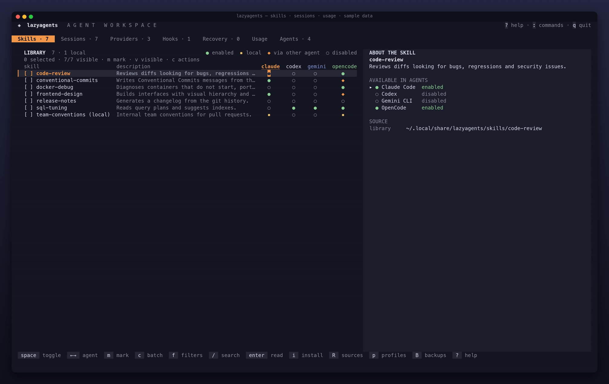
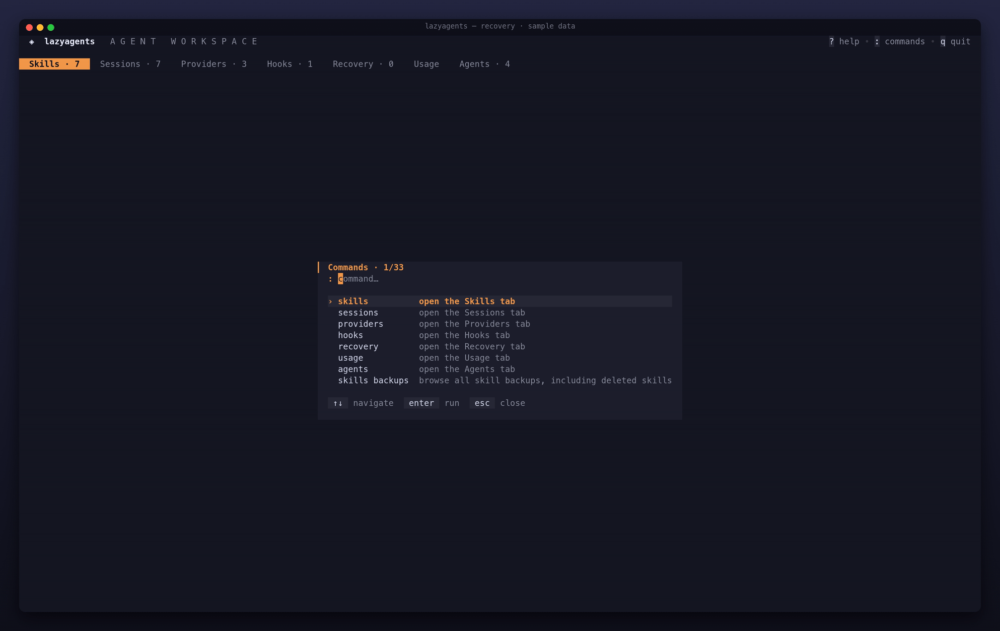
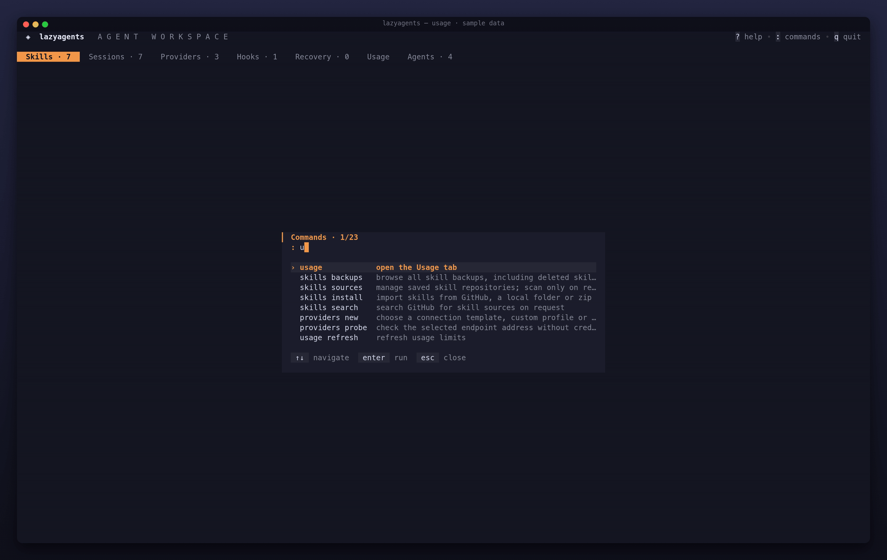

<p align="center"></p>

<h1 align="center">lazyagents</h1>

<p align="center"><strong>The lazygit for AI coding agents.</strong><br>Manage your coding agents from one terminal.</p>

<p align="center">Claude Code · Codex · Gemini CLI · OpenCode · Pi · Crush · Hermes Agent</p>

<p align="center">
  <a href="https://github.com/rogeriojunior31/lazyagents/actions/workflows/ci.yml"></a>
  <a href="https://github.com/rogeriojunior31/lazyagents/releases"></a>
  <a href="https://rogeriojunior31.github.io/en/docs/lazyagents/"></a>
</p>

<p align="center"><b>English</b> · <a href="README.pt-br.md">Português</a></p> <!-- check-english:allow (language name) -->

Different agents keep skills, conversations and configuration in different places. lazyagents brings that work into one library and a browsable history while keeping each tool's native formats.

[Features](#features) · [Installation](#installation) · [Quick start](#quick-start) · [Support](#support) · [Documentation](#documentation)

<p align="center"><a href="docs/assets/demos/hero.mp4"></a></p>

Recorded with sample data at **190×50 cells**. Click to open the original-resolution video. This checkout includes **Unreleased** changes; the website and install command below follow published release **0.2.3**.

## Features

| What you can do | Guide | Demo |
|---|---|---|
| Keep one skill library, enable per agent and review batch actions | [Skills](docs/guide/skills.md) | [Video](docs/assets/demos/skills.mp4) |
| Search, resume, read and export conversations; open verified child sessions | [Sessions](docs/guide/sessions.md) | [Video](docs/assets/demos/sessions.mp4) |
| Save API/local-model connections and review changes before applying | [Providers](docs/guide/providers.md) | [Video](docs/assets/demos/providers.mp4) |
| Manage hooks and review commands installed in each agent | [Hooks](docs/guide/hooks.md) | [Video](docs/assets/demos/hooks.mp4) |
| Inspect backups, restore configuration and review previous operations | [Recovery](docs/guide/recovery.md) | [Video](docs/assets/demos/recovery.mp4) |
| Track limits, tokens and costs with explicit sources and coverage | [Usage](docs/guide/usage.md) | [Video](docs/assets/demos/usage.mp4) |
| Check detection, capabilities and local problems with doctor | [Agents](docs/guide/agents.md) | [Video](docs/assets/demos/agents.mp4) |

<details>
<summary>Watch the module demos at full content width</summary>

### Skills

Enable skills per agent and review batch destinations.

[](docs/assets/demos/skills.mp4)

[Guide](docs/guide/skills.md) · [Open GIF](docs/assets/demos/skills.gif)

### Sessions

Search and read transcripts, including verified child sessions.

[](docs/assets/demos/sessions.mp4)

[Guide](docs/guide/sessions.md) · [Open GIF](docs/assets/demos/sessions.gif)

### Providers

Review Gemini’s two-file changes and connection templates.

[](docs/assets/demos/providers.mp4)

[Guide](docs/guide/providers.md) · [Open GIF](docs/assets/demos/providers.gif)

### Hooks

Review installation before enabling a command.

[](docs/assets/demos/hooks.mp4)

[Guide](docs/guide/hooks.md) · [Open GIF](docs/assets/demos/hooks.gif)

### Recovery

Inspect backups and retained operation history.

[](docs/assets/demos/recovery.mp4)

[Guide](docs/guide/recovery.md) · [Open GIF](docs/assets/demos/recovery.gif)

### Usage

Compare agents, projects and models with cost evidence.

[](docs/assets/demos/usage.mp4)

[Guide](docs/guide/usage.md) · [Open GIF](docs/assets/demos/usage.gif)

### Agents

Inspect detection and run local diagnostics.

[](docs/assets/demos/agents.mp4)

[Guide](docs/guide/agents.md) · [Open GIF](docs/assets/demos/agents.gif)

</details>

## Installation

With **Go 1.26 or newer**:

```sh
go install github.com/rogeriojunior31/lazyagents@v0.2.3
```

Or download a **Linux, macOS or Windows** binary from [Releases](https://github.com/rogeriojunior31/lazyagents/releases) and check `SHA256SUMS`. The [installation and upgrade guide](docs/getting-started.md#install) covers platforms, optional tools and local Homebrew/Arch recipes. The public tap and AUR package have not been published yet.

Use the explicit version above: during renumbering, `@latest` may resolve a retired higher version. lazyagents manages existing agents; install their CLIs separately.

## Quick start

```sh
lazyagents --version
lazyagents doctor --local   # check detection and files without external queries
lazyagents                  # open the interface
```

1. In **Skills**, import a folder or repository with `i` and review activation destinations.
2. In **Sessions**, select a conversation and press `v` to read it or `enter` to resume in the agent's CLI.
3. Use `:` for commands such as `providers`, `recovery` and `agents doctor`.

| Key | Action |
|---|---|
| `tab` / `shift+tab` | switch tabs |
| `↑` / `↓` | select |
| `?` | show help for the current screen |
| `:` | open the command palette |
| `esc` | go back or cancel |
| `q` | quit from the main screen |

The [key reference](docs/reference/keys.md) covers actions by context. The [CLI](docs/reference/cli.md) provides headless listings and operations, including JSON output.

## Support

Claude Code, Codex, Gemini CLI, OpenCode, Pi, Crush and Hermes Agent have different capabilities. Check the [generated matrix and verified versions](docs/reference/agents.md) before relying on a specific feature. Hermes provides skills; Claude Desktop appears in detection only.

Skill activation uses symlinks; Windows requires the corresponding permission. Agent configuration writes have backups and review; previews hide secrets. Subscription limits can query the network when requested. See [Safety and data](docs/safety.md) and [Recovery](docs/guide/recovery.md).

The project is pre-1.0. Commands and formats may change between minor versions; see the [CHANGELOG](CHANGELOG.md).

## Documentation

**[Read online](https://rogeriojunior31.github.io/en/docs/lazyagents/)** · **[This revision's index](docs/README.md)** · [Portuguese](docs/pt-br/README.md)

| You want to… | Reference |
|---|---|
| Install, upgrade and get started | [Getting started](docs/getting-started.md) |
| Follow a module workflow | [Task guides](docs/README.md#guides) |
| Find a command, key or agent capability | [CLI](docs/reference/cli.md) · [Keys](docs/reference/keys.md) · [Agents](docs/reference/agents.md) |
| Configure paths, tabs and appearance | [Configuration](docs/configuration.md) · [Themes](docs/themes.md) |
| Understand writes, backups or a problem | [Safety](docs/safety.md) · [Troubleshooting](docs/troubleshooting.md) |
| Add external tabs and commands | [Plugins](docs/guide/plugins.md) |

The README introduces the product; guides explain workflows and limits. Command and capability references are generated from code. Tests check links and reviewed translations; the website publishes release documentation.

## Contributing

See [CONTRIBUTING](CONTRIBUTING.md) and the [architecture](docs/architecture.md). [BACKLOG](BACKLOG.md) holds the consolidated roadmap, delivered work, next tasks and acceptance criteria. Security issues follow [SECURITY](SECURITY.md).

## License

[MIT](LICENSE). The themes come from [SP Night](https://sp-night.github.io/) and community palettes, under their own licenses ([notices](internal/tui/theme/LICENSES-themes.md)).
