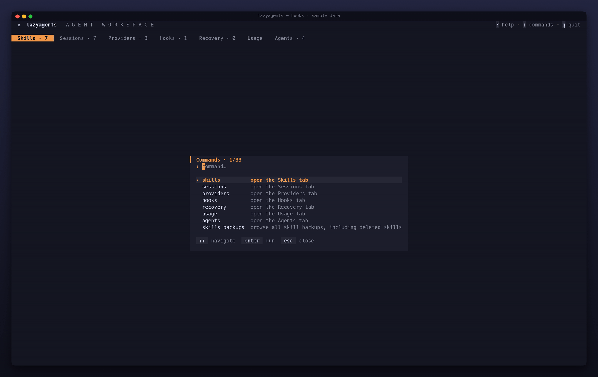

# Hooks

A hook is a shell command that an agent runs when something happens: a session starts, a tool is about to run, a turn ends. lazyagents keeps your hooks in a library and installs them in the agents that support hooks. You can write them by hand or import them from repositories that ship Claude Code plugin hooks. Which agents support hooks, and which events each one fires, is in the [agent support reference](../reference/agents.md#hook-events).



## Concepts

- **Library:** `~/.local/share/lazyagents/hooks/`, one JSON file per hook, named `<name>.json`. You can edit these files by hand.
- **Entry:** a library hook has a name and one or more commands. Each command has an `event`, an optional `matcher` and a `command`. An entry imported from a plugin can hold many commands across several events, and it installs and uninstalls as a unit. You can still switch single commands off.
- **Identity:** an installed hook is recognized by the combination of event, matcher and command. lazyagents adds no marker to the agent's file. Anything in the file that does not match a library entry is a **foreign** hook, and lazyagents only counts it, never edits or removes it.
- **Reach:** a command installs only in agents that fire its event. When an entry mixes events, each agent gets the commands it can run.

An entry in the library:

```json
{
  "name": "notify",
  "description": "desktop notification",
  "hooks": [
    {
      "event": "Stop",
      "command": "notify-send \"Claude finished\""
    }
  ]
}
```

Other fields you may meet: `matcher`, a filter such as a tool name for `PreToolUse`; `timeout` in seconds; `async: true` to run without blocking the turn; and `off`, the indexes of commands switched off. Imported entries also carry `source`, where they came from, and `files`, the folder with their scripts. The name must match the file name and may use letters, digits, `-` and `_`, up to 40 characters.

## In the TUI

The Hooks tab is a hook × agent matrix: `●` installed, `◐` partial (some commands missing), `○` not installed, `–` the agent fires none of the hook's events. The full key list is in the [key reference](../reference/keys.md#hooks-tab).

### Install or uninstall per agent

Pick the agent column with `←/→` and press `space`. The confirmation shows `event → command` and the file that will be rewritten, plus any warning about that agent. Pressing the key again uninstalls. `a` installs the hook in every installed agent that fires one of its events, and `x` uninstalls it from all of them.

`d` deletes a library entry. For an inline hook without managed scripts, installed commands stay in the agents. An imported hook with managed scripts must be uninstalled from every agent first: deletion refuses while any of its commands remains installed, even if the package is only partially installed. The error names each dependent agent and its `lazyagents hooks disable <name> --agent <id>` command. An unreadable agent configuration also blocks deletion, keeping the entry and scripts intact. Unreadable library entries also block deletion until script dependencies can be verified. After uninstalling, deletion removes the scripts unless another library entry still uses the same folder, including equivalent paths or aliases. The CLI command `hooks rm` follows the same rules.

### Switch single commands of a pack

`enter` opens the command list of the selected entry. `space` or `enter` switches a command on or off, and `esc` goes back. If the entry is installed somewhere, the change reaches those agents right away, after a confirmation. If it is not installed anywhere, only the library changes. A result report lists every affected agent. The library flag may already be saved when an agent write fails; retry reconciles only the failed files, even though the flag now matches.

### Read and edit commands and scripts

`v` opens a full-screen reader with the command and the scripts it references (`.sh`, `.py`, `.js` and similar). `←/→` switches between them, and `e` edits the current one in `$EDITOR`. Before saving, a confirmation shows the text before and after. Saving a command also updates every agent where it is installed, and rolls back if one of them fails. Saving a script backs it up first and refuses if the file changed on disk after you opened it.

### Import hooks from a repository

Repositories with Claude Code plugins declare hooks in `<plugin>/hooks/hooks.json`. When you install from such a source with `i` in the Skills tab, those hook files show up in the same picker as the skills. They start unchecked, because installing a hook means running a third-party command on every event.

On import:

- the folders the commands reference through `${CLAUDE_PLUGIN_ROOT}` are copied into the library with their layout, together with `hooks/`. Other folders of the plugin are not copied.
- each command gets `export CLAUDE_PLUGIN_ROOT='<the copy>'; ` in front, and `${CLAUDE_PLUGIN_ROOT}` becomes `$CLAUDE_PLUGIN_ROOT`, since Claude Code rejects the braced form outside its own plugins. The author's quoting is kept.
- one library entry is created per plugin, holding all of its commands. The import is all or nothing, and it refuses a name that is already in the library.

The imported commands target the Claude Code protocol. Other agents may send a different payload on stdin, so the install confirmation reminds you where the hook came from.

### Codex: hooks switch and trust

Codex keeps hooks in `~/.codex/hooks.json`, and two more things in `config.toml`: `[features] hooks = true`, and a `trusted_hash` per command. The hash records that you agreed to let that command run. lazyagents installs the hook but never writes either of these, because writing them would approve a command on your behalf. Instead it warns you, in the confirmation, in `hooks list` and in `doctor`:

- "hooks are off in Codex: set hooks = true under [features] in config.toml"
- "a new hook only runs after you confirm trust in Codex itself"

Claude Code has no trust step: whatever is in `settings.json` runs.

### Crush

Crush runs only `PreToolUse` hooks, and reads their output in Claude Code's format too. lazyagents installs them as `hook add` lines in a block at the end of `~/.config/crush/crushrc`, one per hook, named `lazyagents-<id>` so each one is removed alone; the rest of the file is never touched. `hooks list` also shows the hooks in Crush's `crush.json`; lazyagents never edits that file, so uninstalling one of those says so instead of pretending. Removal is refused before changing `crushrc` if the same hook remains in `crush.json` or that JSON cannot be read. Hooks your `crushrc` defines outside that block are Bash that only running the script would reveal, so they are not listed. A command or matcher that spans several lines cannot be installed in Crush: put it in a script and install the script.

## Bulk results

Bulk apply/clear and install/uninstall operations report each agent as `succeeded`, `failed` or `skipped`, with a reason and state read back after the attempt. Changes are per target: one failure does not undo successful writes, and a failed target may already have partial changes. The matrix reloads from disk even after failure.

The result stays open until dismissed. Scroll long reports, use `r` to retry only failed agent IDs after confirmation, `b` to open Recovery while retaining this report, or `esc`/`enter` to return to the refreshed matrix. Retry reads the current saved entry and keeps previous successful/skipped outcomes; it never repeats the original all-agent selection. See the [key reference](../reference/keys.md) and [Recovery guide](recovery.md). Observed state describes the last attempt for that target. If Recovery is hidden, the report remains available; use `lazyagents config-backups list`.

CLI mutations print per-target diagnostics to stderr, including successes when another target fails. Existing exit codes, success output and list JSON fields stay unchanged. Fix the cause, then repeat the operation with `--agent <failed-id>` for each reported failure; repeating the bulk command would include successful agents again.

## From the CLI

```sh
lazyagents hooks add notify --event Stop --command 'notify-send "Claude finished"' --desc "desktop notification"
lazyagents hooks add guard --event PreToolUse --matcher Bash --command ~/bin/check-bash.sh --timeout 10
lazyagents hooks enable notify                  # every installed agent that fires Stop
lazyagents hooks enable guard --agent codex
lazyagents hooks list                           # where each hook is installed, and foreign counts
lazyagents hooks list --json
lazyagents hooks disable guard
lazyagents hooks rm guard

lazyagents install owner/repo --hooks           # also import the plugin hooks of a source
```

`hooks add` warns when the command's executable is not in `PATH` or not executable, since the hook would otherwise fail silently when the event fires. All subcommands and flags are in the [CLI reference](../reference/cli.md#hooks). Importing is part of [`install`](../reference/cli.md#install).

## Files

| Path | Contents |
|---|---|
| `~/.local/share/lazyagents/hooks/<name>.json` | library entries (`0600`) |
| `~/.local/share/lazyagents/hooks/<plugin>/` | scripts copied from an imported plugin |
| `~/.claude/settings.json` | Claude Code: the `hooks` key |
| `~/.codex/hooks.json` | Codex hooks |
| `~/.local/share/lazyagents/backups/` | a copy of the agent file before each write, the 20 newest per file |

## Safety

- Every install, uninstall and edit backs up the agent's file first and writes it atomically. Hook groups lazyagents does not own are written back byte for byte, including fields it does not know. The one exception is a group that mixes one of your commands with a library command: when uninstalling, that group is rewritten without the library command.
- Every write in the TUI goes through a confirmation that shows the command and the file.
- Deleting a hook only removes scripts inside the hooks library, never anything outside it.
- `doctor` has a hooks section. It reports commands missing from `PATH`, library files that are invalid or whose name does not match the file, per-agent counts (from lazyagents, foreign, partial) and each agent's note.

## Limits

- Only Claude Code, Codex and Crush support hooks; Codex fires fewer events and Crush only `PreToolUse`. See the [events table](../reference/agents.md#hook-events).
- Only `command` hooks are managed. Other hook types in an agent's file are left alone.
- Imported scripts may assume a POSIX shell or tools the plugin author had installed. `doctor` checks the executable, not what the script needs.

Use the [Recovery tab or config-backups CLI](recovery.md) to find configuration snapshots, review redacted differences and restore a verified file. Recovery replaces one whole file after confirmation, including unrelated edits shown in its preview.
