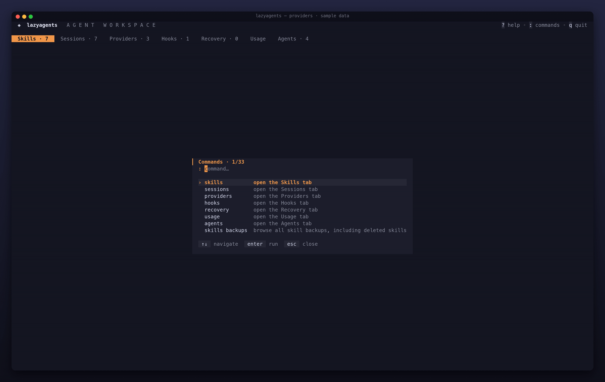

# Providers

A provider profile is a named endpoint, model and token that lazyagents writes into an agent's own config file, so you can switch Claude Code or Codex between the official API, a proxy or a local model without editing JSON or TOML by hand. It works like [cc-switch](https://github.com/farion1231/cc-switch): lazyagents only writes config and never runs a proxy itself. Which agents support it, and which file each one gets, is in the [agent support reference](../reference/agents.md#capabilities).



## Concepts

- **Profile:** `name`, `baseUrl`, `model`, `token`, `envKey` and `wireApi`. A profile has to set at least one of endpoint, model or token. Names are limited to 40 characters.
- **Library:** every profile lives in `~/.config/lazyagents/providers.json`, mode `0600`, because it may hold tokens.
- **Applied:** what an agent's live config says right now. lazyagents reads it back from the agent's file, so a profile you set by hand still shows up, as "provider set outside lazyagents". An applied provider is matched to a library profile by endpoint, and by model when two profiles share an endpoint.
- **Clear:** removes only what lazyagents manages and restores what was there before. The rest of the file is left as it was.

## In the TUI

The Providers tab is a profile × agent matrix: `●` applied, `○` agent default, `–` agent not installed. The detail pane shows the endpoint, model, token state (`token ✓`, never the value) and what each agent has applied. The full key list is in the [key reference](../reference/keys.md#providers-tab).

### Create a profile

Press `n` to open the form. Its fields are name, endpoint, model, token, env var and wire api. `tab` moves between fields and `enter` saves. `ctrl+v` checks the draft against installed agents without saving or applying it; `esc` returns to the form. The check uses the same adapter validation as apply, including the presence of a saved token when editing. The token field stays masked while you type. `e` edits the selected profile: leave the token empty to keep the saved one, which the form never loads. Renaming a profile in the form renames it in the library.

### Apply or clear per agent

Pick the agent column with `←/→` and press `space` to validate that destination. `a` opens the destination selector with installed provider-capable agents selected. Each row says whether the profile is ready or incompatible; select a row to read the reason, affected files and activation requirements. Use `space` to include or exclude agents, then `enter` to review the selection in the existing confirmation. Incompatible selected agents block confirmation: a valid subset must be chosen explicitly. Use `shift+↑/↓` or `ctrl+u/d` to scroll the requirements and `esc` to cancel without writing.

Validation checks endpoint syntax, credential-reference syntax, agent-specific protocol/model requirements and the native files/state needed for the edit. All selected destinations are checked before any configuration, backup or ownership record is written. A Codex token without `envKey`, unsupported protocol, malformed managed block or unreadable native config prevents the entire apply. Files are read and checked again at write time. Authentication and actual endpoint/model support are not tested: a valid environment-variable name is only a reference. No variable value is read or exported by validation. Start a new agent session after applying so it loads the settings and any required environment variables.

Pressing `space` on the profile that is already applied clears it. `x` clears the provider from every installed agent. `d` deletes a profile from the library but leaves agents where it was applied untouched. Use `x`, or clear per agent, to undo those.

### What is written to Claude Code

Claude Code gets three keys in the `env` block of `~/.claude/settings.json`:

```json
{
  "theme": "dark",
  "env": {
    "ANTHROPIC_AUTH_TOKEN": "sk-…",
    "ANTHROPIC_BASE_URL": "https://proxy.example.com",
    "ANTHROPIC_MODEL": "my-model"
  }
}
```

Only those three keys change. Other `env` variables and every other key in the file keep their values and their order; a new key goes at the end of `env`. lazyagents remembers which of the three keys it wrote, so it only ever removes its own:

- A profile field that is empty leaves the key alone if you set it yourself. If lazyagents wrote it for a previous profile, it is removed: switching from a profile with a model to one without drops the old model.
- When a profile replaces an endpoint or model you had set by hand, clearing puts your value back. A token you had set by hand is not kept by lazyagents (it is a secret); it stays in the backup of `settings.json`.
- A key you edited after lazyagents wrote it is yours again, and clearing leaves it.
- Clearing removes the `env` block too if lazyagents created it and it ends up empty. Applying and then clearing gives back the original file.

The record lives in `~/.local/share/lazyagents/claude-provider-state.json` (mode 0600) and holds only a fingerprint of each value lazyagents wrote, never the token. Without a record (nothing applied yet, or a provider applied by v0.2 or earlier), no key counts as lazyagents': `x` leaves them, so a proxy or Bedrock setup you wrote by hand is never cleared. Remove keys left by an old version by hand; the backups dir has the file as it was.

When a token is written, the file mode is tightened to `0600`.

### What is written to Codex

Codex keeps its own state in `~/.codex/config.toml`, such as `[projects.*]` trust entries and hook trust hashes. lazyagents does not parse or rewrite that file. It edits only blocks between `# lazyagents — managed block` markers and copies every other line unchanged:

```toml
# lazyagents — managed block start (do not edit by hand)
model_provider = "lazyagents"
model = "qwen3"
# lazyagents: previous model = "gpt-5"
# lazyagents — managed block end

[projects."/home/me/app"]
trust_level = "trusted"

# lazyagents — managed block start (do not edit by hand)
[model_providers.lazyagents]
name = "local"
base_url = "http://localhost:11434/v1"
env_key = "OLLAMA_KEY"
wire_api = "responses"
# lazyagents — managed block end
```

The top-level keys go before the first table, and the provider table goes at the end. Your previous `model` and `model_provider` are kept as comments inside the block, and clearing puts them back. Applying and then clearing gives back the original file.

For Codex, a profile needs an endpoint. `wireApi` may only be `responses`, which is also Codex's default.

### Pi

Pi keeps custom providers in `~/.pi/agent/models.json`. lazyagents writes one provider there, `lazyagents`, and makes it Pi's default in `~/.pi/agent/settings.json` (`defaultProvider` and `defaultModel`). Every other provider and setting stays as it is:

```json
{
  "providers": {
    "lazyagents": {
      "name": "lazyagents: local",
      "baseUrl": "http://localhost:11434/v1",
      "api": "openai-completions",
      "apiKey": "$OLLAMA_KEY",
      "models": [{ "id": "qwen3" }]
    }
  }
}
```

Pi only offers the models a custom provider declares, so a profile for Pi needs both an endpoint and a model. `wireApi` picks Pi's API: empty or `chat` for OpenAI-compatible chat completions, `responses` for the OpenAI Responses API, `anthropic` for Anthropic Messages. Your previous default provider and model are remembered in lazyagents' data dir, and clearing puts them back, unless you already picked another provider in Pi. A `models.json` created by the profile is removed on clear.

### Crush

Crush's config is `crushrc`, a Bash script of commands such as `provider add` and `model large`, run top to bottom so that later lines win. lazyagents adds one block at the end of `~/.config/crush/crushrc` (or the dir `CRUSH_GLOBAL_CONFIG` names) and never touches your own lines:

```bash
# lazyagents — managed block start: provider (do not edit by hand)
provider add lazyagents --name 'lazyagents: local' --type openai-compat --base-url 'http://localhost:11434/v1' --api-key "$OLLAMA_KEY"
model add 'lazyagents/qwen3' --name 'qwen3'
model large 'lazyagents/qwen3'
# lazyagents — managed block end: provider
```

Being last, the block's `model large` wins over yours; clearing removes the block, so your own settings apply again with nothing to restore. Every value is single-quoted, so what a profile holds is never run as Bash, and an env var is written as `"$VAR"` for Crush to expand. A profile for Crush needs an endpoint and a model; `wireApi` is empty or `chat` (OpenAI-compatible) or `anthropic`. A `crushrc` lazyagents created is removed when the block goes. If you also keep a `crush.json` in the same folder, Crush merges both (the `crushrc` wins) and logs a warning.

### Tokens and `--env-key`

Claude Code reads the token from `settings.json`, so lazyagents writes it there. Claude always uses Anthropic Messages; the profile's `wireApi` and `envKey` do not change its protocol or supply its token. Use a saved token or configure native authentication separately. Codex reads the token only from an environment variable named by `env_key`, so lazyagents never copies a token into `config.toml`. Pi takes either: a token goes into `models.json`, which lazyagents makes 0600, and an env var becomes `"apiKey": "$VAR"`, which Pi resolves itself. Pi hides a custom provider's models until it has a credential, so a profile with neither (a local Ollama, say) gets the placeholder `"apiKey": "lazyagents-no-key"`, as Pi's own docs do. For Codex, set the env var field (`--env-key` in the CLI) and export that variable in your shell:

```sh
export OLLAMA_KEY=…   # in your shell profile
```

Applying a profile that has a token but no `envKey` to Codex fails with an explanation, instead of writing a config that silently has no token.

## Bulk results

After validation passes, apply/clear operations report each agent as `succeeded`, `failed` or `skipped`, with a reason and state read back after the attempt. Changes are per target: one failure does not undo successful writes, and a failed target may already have partial changes. The matrix reloads from disk even after failure.

The result stays open until dismissed. Scroll long reports, use `r` to retry only failed agent IDs after confirmation, `b` to open Recovery while retaining this report, or `esc`/`enter` to return to the refreshed matrix. Retry reads the current saved entry and keeps previous successful/skipped outcomes; it never repeats the original all-agent selection. See the [key reference](../reference/keys.md) and [Recovery guide](recovery.md). Observed state describes the last attempt for that target. If Recovery is hidden, the report remains available; use `lazyagents config-backups list`.

CLI mutations print per-target diagnostics to stderr, including successes when another target fails. Existing exit codes, success output and list JSON fields stay unchanged. Fix the cause, then repeat the operation with `--agent <failed-id>` for each reported failure; repeating the bulk command would include successful agents again.

## From the CLI

```sh
# a proxy for Claude Code; the token comes from stdin, so it stays out of shell history
pass show work/proxy-token | lazyagents provider add proxy \
  --base-url https://proxy.example.com --model my-model --token -

# a local model for Codex
lazyagents provider add local --base-url http://localhost:11434/v1 \
  --model qwen3 --env-key OLLAMA_KEY --wire-api responses

lazyagents provider validate proxy --json   # no writes or network requests
lazyagents provider validate local --agents codex,pi
lazyagents provider apply local --agents codex,pi
lazyagents provider apply proxy --agent claude-code
lazyagents provider apply local --agent codex
lazyagents provider list            # tokens show as ••••, or $VAR for envKey
lazyagents provider list --json     # tokens left out; "has_token": true instead
lazyagents provider clear           # every installed agent
lazyagents provider rm proxy
```

Without `--agent` or `--agents`, `apply` validates every installed agent that supports providers; an incompatible target prevents all writes. Select a subset explicitly with `--agent id` or `--agents id,id`. `clear` keeps its existing `--agent` behavior and defaults to every installed provider-capable agent. Runtime write failures can still be partial: other targets are processed and errors are reported together. All subcommands and flags are in the [CLI reference](../reference/cli.md#provider).

## Files

| Path | Contents |
|---|---|
| `~/.config/lazyagents/providers.json` | the profile library (`0600`) |
| `~/.local/share/lazyagents/claude-provider-state.json` | which Claude Code `env` keys lazyagents wrote (fingerprints only, `0600`) |
| `~/.claude/settings.json` | Claude Code: the `env` block |
| `~/.codex/config.toml` | Codex: the managed blocks |
| `~/.local/share/lazyagents/backups/` | `settings.json.<timestamp>` and `config.toml.<timestamp>`, the 20 newest of each |

## Safety

- Every apply and clear first copies the agent's file into the backups folder, with the same mode as the original. The new file is then written atomically, through a temporary file and a rename.
- Tokens are masked everywhere: the TUI shows `token ✓`, `provider list` shows `••••` and `--json` leaves the field out. Only `provider list --reveal` prints them.
- Every write in the TUI goes through a confirmation that names the affected files. Provider validation writes nothing and does not authenticate credentials. Endpoint URLs with embedded credentials or fragments and invalid environment-variable names are refused.
- `doctor` has a providers section. It reports what each agent has applied, and flags a provider applied to an agent that is not installed or a config that could not be read.

## Limits

- Only Claude Code, Codex, Pi and Crush support providers. Other agents appear in `provider list` only once they gain the capability.
- Multiline strings (`"""` or `'''`) and arrays spread over several lines in Codex's config are kept as written: a line inside them is never read as a key, a table or a lazyagents marker. A string or array that never closes is refused and the file left untouched; so are broken or nested managed blocks, and a `[model_providers.lazyagents]` table you wrote yourself outside a managed block.
- An applied profile is recognized by endpoint and model. Two profiles with the same endpoint and model look the same.

Use the [Recovery tab or config-backups CLI](recovery.md) to find configuration snapshots, review redacted differences and restore a verified file. Recovery replaces one whole file after confirmation, including unrelated edits shown in its preview.
