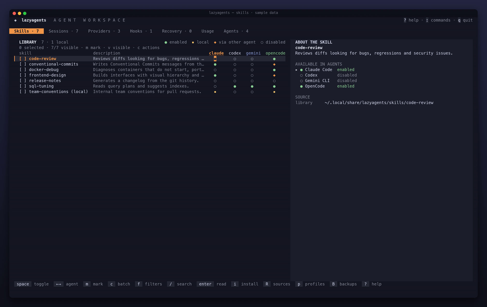

# Skills

A skill is a folder with a `SKILL.md`: instructions an agent loads when the task matches its description. Each agent reads skills from its own directory, so the same skill usually ends up copied in several places. lazyagents keeps one copy in a central library and makes it visible to each agent through a symlink, so you install and update a skill once and choose per agent where it is enabled. The Skills tab shows this as a skill × agent matrix, and the same operations are available from the CLI.



## Concepts

**Library.** The folder where lazyagents keeps the skills it manages: `~/.local/share/lazyagents/skills/` by default, or `libraryDir` in `config.yaml` (see [Configuration](#configuration)). Each skill is one subfolder, named after the skill.

**Activation is a symlink.** Enabling a skill in an agent creates a symlink `<agent skills dir>/<skill> → <library>/<skill>`. Disabling removes that symlink and nothing else. Since the agent reads the library folder through the link, editing or updating a skill applies to every agent at once. Where each agent reads its skills is in the [agent reference](../reference/agents.md#skills).

**Local skills.** A skill that lives in an agent's directory as a real folder, or as a symlink created by another tool, is *local*: lazyagents shows it, but never deletes or disables it. To manage it, *adopt* it into the library (see [Adopt local skills](#adopt-local-skills)).

**Shared directories.** `~/.agents/skills` is read by Codex, Gemini CLI, OpenCode, Pi and Crush. Enabling a skill for one agent only shows it to that agent: lazyagents links it in the agent's own directory (`~/.codex/skills`, `~/.gemini/skills`…). Only when the skill is enabled for every installed agent that reads `~/.agents/skills` does it become a single link there; disabling it for one of them moves it back to the own directory of each agent that keeps it. The exception is `~/.claude/skills`, Claude Code's own directory, which OpenCode and Crush also read: a skill enabled for Claude Code shows up in them too.

**Matrix markers.** Each cell of the matrix shows the skill's state in one agent:

| Marker | Meaning |
|---|---|
| `●` | enabled by lazyagents (a symlink in this agent's own directory) |
| `◆` | visible through another agent's directory (OpenCode reading `~/.claude/skills`); it cannot be toggled for this agent alone |
| `▪` | local: real content lazyagents does not manage |
| `○` | not visible to this agent |

**Profiles.** A profile is a named snapshot of the matrix: which library skills are enabled in which agents. Applying one brings the matrix back to that state, for example to switch between a "work" and a "personal" set.

**Backups.** Before a skill folder is removed, replaced, restored over, adopted or migrated, lazyagents writes a `.tar.gz` of it to `~/.local/share/lazyagents/backups/`. The 20 newest backups of each skill are kept.

## In the TUI

The matrix has one row per skill and one column per installed agent that has a skills directory. `←`/`→` pick the agent column; the selected skill's detail (description, source, per-agent state and lint warnings) shows beside or below the table. The complete list of keys is in the [key reference](../reference/keys.md#skills-tab), and `?` shows it inside the TUI.

### Browse and read

Move through the inventory and type `/` to search name, description, folder/path and recorded source (including repository and source subfolder). Matching is fuzzy and case-insensitive; for example, search a purpose such as `database` or a repository name such as `everything-claude-code`. Press `enter` to keep the query, including when no rows match; `esc` clears text search while retaining state filters. `enter` opens the `SKILL.md` rendered as Markdown; inside the reader, `e` opens it in your editor and `esc` goes back. `r` rescans the library and the agents' directories. The tab counter covers the full inventory; the matrix also counts visible local rows outside the library.

### Combine text and state filters

Press `f` to choose a small fixed set of filters. `↑/↓` selects a field and `←/→` or `space` cycles its value. Location includes the whole inventory, library only or local only. Agent includes any activation state, enabled anywhere, nowhere enabled or enabled in a specific installed agent; local and shared visibility count as enabled. Metadata can include everything or only invalid frontmatter/lint issues. Updates can include everything, available updates, locally edited, up to date or unchecked/unknown.

`enter` applies these filters together with the text query; `esc` cancels the draft. `r` inside the panel resets draft state filters while preserving text. `F` from the matrix clears both text and state filters. The header shows visible/total counts and active state filters. Selection follows the same folder when it remains visible, including when display names repeat; otherwise it moves to a valid visible row, and an empty result has no actionable selection. Details always follow that row.

Filters use the loaded scan and cached lint only: typing and changing filters do not read files, clone repositories or make network requests. `r` from the matrix rescans metadata/activation while preserving filters. Update filters use the last explicit `U` check, which can be stale; unchecked/unknown also covers skills without a usable Git check. Updating a skill invalidates cached update states; run `U` again when needed. An empty update filter does not prove the inventory is up to date.

Filters change visible rows and prune hidden marks. Use the [selected-row workflow](#act-on-selected-rows) for filtered bulk actions. `space`, `a`, `x`, `u` and `d` still act on the selected visible skill. `A` (adopt all), `U` (check/update all Git skills) and saved profile operations keep their full-inventory scope, as shown in their existing confirmations. See [profiles](#profiles) before saving or applying a matrix.

### Act on selected rows

Use `m` or click a row's checkbox to mark its folder. `v` replaces the selection with every row matching the current text/state filters, including rows off screen; `V` clears it. The header distinguishes selected, visible and total counts. Changing filters or reloading automatically unmarks hidden or removed rows; clearing filters does not restore those marks. To select the whole inventory, clear filters with `F`, then use `v`.

Press `c` to open **Selected skill actions**. Choose enable, disable, update or remove. For activation, the initial destination is the current agent column: toggle individual agents in the panel, select all with `a` or none with `x`. At least one destination is required. `enter` opens a confirmation listing every canonical folder, selected/visible/total counts and agent destinations. The reviewed folders and agent paths are frozen; a later scan cannot add rows or destinations. Cancelling returns to the draft without writes. Existing single-row keys remain single-row actions even when rows are marked.

Enable/disable applies only to the listed skill/agent pairs, preserving other activation states where native readers allow it. Shared links may move to retain visibility; an agent that also reads another agent's own folder can still see its skills, as explained under [shared directories](#concepts). Local folders and foreign links remain protected.

Update and remove act on the selected **library copies**, affecting every agent reading those copies, rather than a chosen subset of agents. The confirmation makes that scope explicit. Updates fetch the reviewed Git sources and use the existing backup/replacement operation; local edits, missing install hashes, non-Git skills and external library links are skipped. A changed recorded source requires a new review. Removal archives each library copy before deleting it and its managed links; failed link cleanup keeps the library copy for retry. Neither operation deletes local/foreign agent copies. The persistent [bulk report](#bulk-results) identifies each skill/agent pair, or skill/library operation, and retries only failed entries.

### Enable and disable

- `space` toggles the selected skill in the agent under the cursor (`←/→` picks the column).
- `a` enables the skill in every installed agent that has a skills directory; `x` disables it everywhere lazyagents manages it.

A cell marked `▪` or `◆` cannot be toggled from its column: the toast explains why (adopt a local skill with `o`, or use `x` for a skill that reaches the agent through another agent's directory). Only library skills can be enabled.

### Install from GitHub, a folder or a zip

Press `i` and type a source:

- `owner/repo` or any git URL (`https://…`, `git@…`, `….git`): cloned with `git clone --depth 1` into a temporary folder, so `git` must be in `PATH`.
- A path to a `.zip` file.
- A local folder (`~` is expanded).

lazyagents looks for every folder with a `SKILL.md`, at any depth. If the source root has one, the source itself is the skill. `.git`, `node_modules` and `vendor` are skipped; when two folders have the same name, the one outside hidden directories and closest to the root wins. A picker then lists what was found, all skills checked: `space` toggles one, `a` toggles all, `enter` installs, `esc` cancels.

Installing only copies into the library and records the source in `.origin.json` inside the skill folder. Nothing is enabled until you enable it. A name that already exists in the library is not overwritten: that item fails and the rest of the install goes on.

**Marketplaces.** When the source has a Claude Code marketplace manifest (`.claude-plugin/marketplace.json`) that declares skills, lazyagents reads the manifest instead of scanning, and the picker prefixes each skill with the name of its plugin. Plugins whose source is another repository or a package are not fetched; they show up as notes in the picker.

**Hooks in the same source.** If the source ships `hooks/hooks.json` (the Claude Code plugin format), its hooks appear in the same picker, unchecked, because a hook runs a third-party command on every agent event. See the [hooks guide](hooks.md).

### Search GitHub

`S` searches GitHub code for `SKILL.md` files that contain your term and lists the repositories found, with their descriptions. `enter` on a result starts the install flow above for that repository. The search goes through `gh api`, so it needs the [GitHub CLI](https://cli.github.com/) installed and logged in. It only runs when you ask for it.

### Create and edit

`n` asks for a name in kebab-case (lowercase letters, digits and hyphens, at most 64 characters) and creates `<library>/<name>/SKILL.md` from a template with `name` and `description` filled in. `e` opens the selected skill's `SKILL.md` in `$EDITOR` (`vi` if unset), suspending the TUI until the editor exits.

### Adopt local skills

`o` adopts the selected local skill: its folder is copied into the library, the original is backed up, and the original is replaced by a symlink to the library copy. The agent keeps seeing the skill, and the other agents can now enable it. `A` adopts every local skill at once, after a confirmation that lists them.

A skill that is a symlink created by another tool cannot be adopted: manage it with the tool that created it. A name that already exists in the library is refused too.

### Update from source

Skills installed from a git source can be updated; skills from a zip, a folder or created by hand cannot.

- `u` updates the selected skill after a confirmation: the repository is cloned again, the current folder is backed up and its content is replaced in place, so the agents' symlinks keep working.
- `U` checks every git-sourced skill, cloning each repository once, and marks the matrix: `↑` update available, `~` edited locally. If updates are available, it asks to apply them all. Skills edited locally are skipped, so your changes are not overwritten; `u` updates one of them anyway, with a backup first.

lazyagents detects local edits by comparing the folder's content with the hash it saved at install or update time.

### Profiles

`p` opens the profile list:

- `s` saves the current matrix as a profile. Only the enablements lazyagents controls are recorded: local skills and skills seen through another agent's directory are left out.
- `enter` on a profile shows what applying it would change (`+` enable, `−` disable, per skill and agent) and asks for confirmation.
- `d` deletes the selected profile after a confirmation. Skills stay enabled as they are.

Applying a profile enables each listed library skill in the agents the profile names and disables the other library skills where lazyagents enabled them. Local skills are never touched. A profile that names a skill no longer in the library is refused.

Profiles are stored in `~/.local/share/lazyagents/profiles.json`.

### Backups and restore

`B` or `: skills backups` opens all skill backups, newest first, including skills removed from the library. `b` opens backups of the selected skill; without a selection it opens all backups too. This works after removing the last skill and reopening an empty library, including legacy folder names containing dots.

Each row shows the original folder name and local date. Press `/` to filter by name or date (`YYYY-MM-DD`); query words must all match, ignoring case. `enter` applies the filter, then another `enter` asks to restore the selected archive. `esc` while editing clears the filter; outside the filter it returns to Skills. Cancelling a restore keeps the filtered list open.

The current folder, if any, is backed up before being replaced, so a restore can itself be undone. The backup is unpacked to a temporary folder and checked before the current folder is swapped out, so a corrupt backup leaves the skill as it was. Restoring recovers library files only: existing agent links keep working, but links removed when deleting a skill are not recreated. Enable the restored skill explicitly where you want it.

The CLI provides the same inventory through [`backups`](../reference/cli.md#backups), including JSON output, and restores an exact listed archive filename or path through [`restore`](../reference/cli.md#restore).

### SKILL.md lint

Every skill is checked against the [Agent Skills](https://agentskills.io) format, and problems show in the detail panel and in `lazyagents doctor`:

- `name` is present, in kebab-case and equal to the folder name;
- `description` is not empty and has at most 1024 characters;
- there are instructions after the frontmatter.

A `SKILL.md` whose frontmatter cannot be parsed is flagged as invalid instead.

## Bulk results

Enabling/disabling a skill in all agents and applying a skill profile show `succeeded`, `failed` and `skipped` agent results. Local/foreign copies are preserved, unavailable agents are skipped, and state is scanned again after every attempt. Some links may already have changed when another path fails; old links remain until replacement links can be created safely.

The report remains until dismissed. Scroll it, use `r` to confirm a retry of failed agent IDs only, `b` to open skill backups, or `esc`/`enter` to return to the refreshed matrix. Retry rescans current state and reads the saved profile again. Shared-link placement still runs together to preserve other agents' visibility; it can move shared links while keeping their requested state. See the [key reference](../reference/keys.md#skills-tab).

CLI bulk enable/disable and `install --all` print each agent's result to stderr, preserving existing exit codes and list JSON fields. Fix the failure and use `enable <skill> --agent <failed-id>` or `disable <skill> --agent <failed-id>` to retry only that agent. For `install --all`, retry activation with `enable`, without reinstalling the library skill. Activation changes links only: [skill archives](#backups-and-restore) restore library files, while `space` or CLI enable/disable adjusts visibility.


## From the CLI

The CLI covers the everyday operations. Every command is described in the [CLI reference](../reference/cli.md#list), and `lazyagents help <command>` prints the same text.

```sh
lazyagents install anthropics/skills            # install every skill in a repository
lazyagents install ./my-skills.zip --hooks      # also install the hooks it ships
lazyagents install anthropics/skills pdf docx   # only these skills from the repository
lazyagents install DietrichGebert/ponytail --all  # install and enable in every installed agent
lazyagents list                                 # skills, agent count, library or local
lazyagents enable pdf --agent claude-code       # enable in one agent
lazyagents disable pdf --agent codex
lazyagents enable pdf                           # every installed agent, like a in the TUI
lazyagents adopt my-notes --agent claude-code   # move a local skill into the library
lazyagents remove pdf                           # remove from the library, with backup
lazyagents skills backups --query pdf           # find backups even after removal
lazyagents skills backups --json
lazyagents skills restore pdf.20261017T120000.tar.gz  # use the exact filename from backups
lazyagents list --json | jq '.[] | select(.valid | not) | .dir'
```

`lazyagents skills <command>` is an alias for the same commands. Search for new skills, create, update and profiles are only in the TUI for now.

## Configuration

```yaml
# ~/.config/lazyagents/config.yaml
libraryDir: ~/.agents/skills
```

`libraryDir` moves the library. Setting it by hand only changes where lazyagents looks; the existing skills and the symlinks that point to them stay where they were. To move them too, use [`lazyagents migrate-library <dir>`](../reference/cli.md#migrate-library): it backs up and copies every skill, repoints the agents' symlinks, saves `libraryDir`, and only then removes the old copies. It refuses when a skill name already exists in the destination (symlinks included) or when one directory contains the other; resolve the conflict and run it again.

Pointing the library at `~/.agents/skills` makes every skill visible to Codex, Gemini CLI, OpenCode, Pi and Crush without any symlink, since they read that directory; the price is that they can no longer be enabled per agent. The other options are in the [configuration guide](../configuration.md).

## Files

| Path | Written when |
|---|---|
| `~/.local/share/lazyagents/skills/<name>/` | install, create, adopt, update, restore, remove |
| `~/.local/share/lazyagents/skills/<name>/.origin.json` | install and update: source type, URL or path, subfolder, content hash |
| each agent's skills directory | enable and disable (symlinks only), adopt (the original becomes a symlink), remove (links into the library) |
| `~/.local/share/lazyagents/backups/<name>.<timestamp>.tar.gz` | remove, update, adopt, restore, migrate-library (mode 0600, 20 per skill) |
| `~/.local/share/lazyagents/profiles.json` | saving a profile |
| `~/.config/lazyagents/config.yaml` | `migrate-library` (`libraryDir`) |

Git clones and extracted zips go to temporary folders that are removed after the install.

## Limits

- Symlinks inside a skill folder are not copied on install, adopt or migrate, so a skill cannot pull in files from outside its folder. Zip entries that are symlinks or escape the archive root are skipped, and a zip over the limits fails the install before anything reaches the library: an entry over 64 MB, more than 512 MB uncompressed in total, or more than 10,000 entries.
- Enabling uses symlinks. On Windows, creating them may need Developer Mode or administrator rights.
- Hermes Agent's per-project skill dirs (`<project>/.hermes/skills`, after `hermes skills trust`) are not read; its `external_dirs` are.
- Skills bundled inside Claude Code plugins are not managed.
- The TUI does not watch the filesystem: press `r` after changing skill folders by hand.
