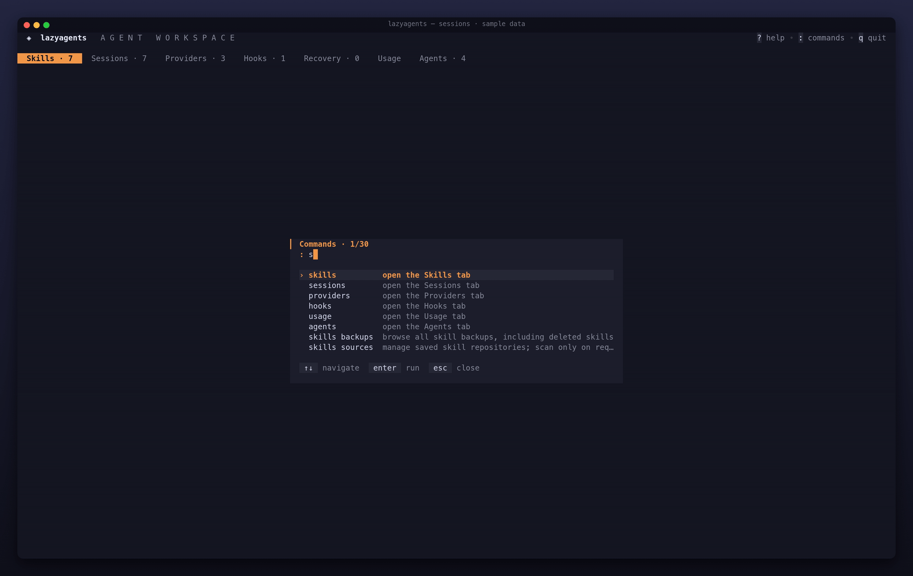

# Sessões
<!-- source: 32efbf04c8f1 -->

A aba Sessions reúne conversas de todos os agentes numa lista, das mais recentes às mais antigas. Você pode retomar na CLI do próprio agente, ler, buscar, exportar, nomear e excluir sessões. O lazyagents apenas lê os arquivos de sessão das CLIs; só os altera ao excluir uma sessão.



<a id="concepts"></a>

## Conceitos

Uma lista vazia orienta a iniciar uma conversa num agente compatível e usar `r` para reler sessões locais. Use `agents` na paleta para inspecionar a detecção ou `skills install` para importar sua primeira skill. Resultados vazios por filtro orientam a ajustar os filtros existentes; não significam que as sessões de origem foram excluídas.

- **Sessão:** conversa com um agente, com a primeira mensagem como título, pasta de execução e horário da última atualização.
- **Alias:** nome que você dá a uma sessão. O lazyagents o guarda em arquivo próprio, nunca nos dados da CLI. O filtro pesquisa aliases e títulos.
- **Sessão em execução:** conversa ainda aberta por um processo do agente. Mostra `●` e não pode ser excluída antes de você fechá-la.
- **Índice de conversas:** o lazyagents lê cada conversa uma vez e depois apenas o trecho acrescentado. Isso acelera a recarga de históricos grandes. O índice é um cache descartável ([Arquivos](#files)).

<a id="where-sessions-come-from"></a>

## Origem das sessões

| Agente | Leitura | Retomada | Observações |
|---|---|---|---|
| Claude Code | `~/.claude/projects/<project>/*.jsonl` | `claude --resume <id>` | indicador de execução e tokens por sessão; também lê subagentes em `<project>/<id>/subagents/` |
| Codex | `~/.codex/sessions/**/*.jsonl` (rollouts) | `codex resume <id>` | |
| Gemini CLI | conversas em `~/.gemini/history/<project>/` e `~/.gemini/tmp/<project>/` | `gemini --resume <id>` | a pasta vem do mapa de projetos; ordena por `lastUpdated`/`startTime` nativos, usando a data do arquivo só como alternativa |
| OpenCode | `~/.local/share/opencode/opencode.db` | `opencode --session <id>` | usa o binário `sqlite3`, em modo somente leitura; até 500 sessões principais recentes |
| Crush | `<project>/.crush/crush.db` para cada projeto em `~/.local/share/crush/projects.json` | `crush --session <id>`, no projeto | usa `sqlite3` em modo somente leitura; sessões de subagentes aparecem dentro da sessão que os iniciou |
| Pi | `~/.pi/agent/sessions/<project>/*.jsonl` | `pi --session <file>` | também aceita `PI_CODING_AGENT_SESSION_DIR` ou `sessionDir` absoluto em `settings.json`; título dado por `/name` ou pela primeira mensagem; mostra só o ramo ativo |

Esses são os caminhos padrão. Agentes movidos por suas [variáveis de configuração](../reference/agents.md#config-overrides), como `CLAUDE_CONFIG_DIR`, `CODEX_HOME`, `XDG_DATA_HOME` ou `OPENCODE_DB`, são lidos na localização correspondente.

Claude Desktop e Hermes Agent não têm sessões locais legíveis pelo lazyagents. Outros recursos de cada agente estão na [referência dos agentes](../reference/agents.md#capabilities).

Requisitos:

- **OpenCode:** exige `sqlite3` no `PATH` para listar e ler sessões. Sem ele, os demais agentes continuam carregando e o erro identifica o binário ausente.

OpenCode 1 e 2 usam tabelas nativas diferentes. O lazyagents lê as tabelas de
sessões e mensagens V2 quando presentes; linhas antigas preservadas não
reaparecem após uma exclusão no V2. Bancos antigos continuam usando o leitor
V1. Os dois formatos têm fixtures reais de regressão. O controle de providers
e o histórico de uso têm evidências e limites próprios; veja as versões e
os limites das gravações na [referência de suporte](../reference/agents.md#recorded-compatibility-evidence).
- **Indicador de execução:** no Linux, lê `/proc` diretamente. Nos demais sistemas, executa `lsof` uma vez por carga. Sem `lsof`, nenhuma sessão é marcada como em execução.

<a id="in-the-tui"></a>

## Na TUI

As teclas estão na [referência](../reference/keys.md#sessions-tab); `?` as mostra na interface. O painel lateral mostra pasta, ID e tokens da sessão quando o agente registra consumo, além do custo estimado para autenticação por chave de API. Custos registrados pelo próprio agente (Pi e Crush) aparecem sem `~`. Crush registra custo, mas não os tokens da sessão inteira, então suas sessões não têm a linha de tokens.

<a id="resume-a-session"></a>

### Retomar uma sessão

Pressione `enter`. O lazyagents suspende a interface, executa a retomada na pasta da sessão e volta quando o agente sai. Se a pasta não existir mais, pede outra. Para escolher a pasta manualmente, use `R`. O campo aceita `~`.

Para copiar o comando em vez de executá-lo, pressione `c`: a linha de estado mostra `cd <pasta> && <comando>`.

O binário do agente precisa estar no `PATH`. Agentes sem retomada pela CLI mostram um erro.

<a id="read-a-transcript"></a>

Gravações Linux/amd64 verificam retomada sem interface interativa e backup/exclusão
pelo adaptador no Gemini CLI 0.64.0 e no OpenCode 2.0.32. O teste OpenCode usa
`run --session` com a mesma opção de ID nativa; não cobre a abertura da TUI
interativa. Veja escopo e reprodução nas [evidências gravadas](../reference/agents.md#recorded-compatibility-evidence).

### Ler uma conversa

`v` abre a conversa como registro: cada mensagem sua é um título numerado; cada turno do agente fica atrás de uma barra na cor dele. O turno mostra a resposta e as mensagens após o último comando. O trabalho anterior (progresso, raciocínio e comandos) fica recolhido numa linha `⋯` com contagens.

Para Claude Code, Codex, Gemini CLI, Pi, OpenCode e Crush, o leitor mostra o horário das mensagens e a duração do trabalho. Compactações, interrupções, mudanças de modelo e ramos do Pi (`branch 2 of 3`, seguido dos outros ramos) aparecem entre turnos. Comandos com `/` aparecem como foram digitados. Falhas recebem `✗`; Codex não associa a falha à chamada, então seus comandos não recebem essa marca. Um resumo do Crush aparece como compactação.

No Gemini, snapshots repetidos de mensagens e ferramentas aparecem uma vez,
com conteúdo e status mais recentes e horários nativos. Atualizações da retomada
podem substituir e reordenar conteúdo; o leitor nunca reescreve o arquivo.

Sessões filhas do OpenCode 2 e do Crush abrem pela chamada do subagente que as
originou. O vínculo exige IDs gravados de mensagem/chamada e um pai nativo
correspondente; dados ausentes ou divergentes deixam a chamada visível sem link.
Vínculos de filhos do OpenCode 1 não foram verificados. A lista principal e o
inventário de uso do OpenCode continuam limitados às sessões principais (até
500 no OpenCode); abrir um filho não soma seu uso aos totais do pai.

Chamadas são mostradas pelo que fizeram: `$ comando` para shell, `✎ arquivo +3 −1` para edição com linhas adicionadas e removidas, texto discreto para leituras, buscas e consultas web, e `⎇` para subagentes, com contagem de chamadas quando o Claude Code guardou a conversa. A linha `⋯` conta arquivos editados. Planos propostos pelo agente (modo de planejamento do Claude Code) aparecem como documentos; tarefas aparecem como lista com contagem das concluídas. No leitor:

- `n/N` alternam entre suas mensagens. `g/G` vão ao começo e ao fim. A partir de 150 colunas, uma faixa à esquerda lista as mensagens com horários e marcas (`✎` edição, `✗` falha, `⎇` subagente), destacando a atual.
- `m` alterna entre **log** (registro padrão), **conversation** (mensagens e respostas, sem etapas) e **actions** (mensagens e chamadas, sem mensagens de progresso: o que foi feito nos arquivos e shell).
- `]/[` escolhem o próximo ou anterior turno com etapas recolhidas, subagente ou ramo (`▶`). `enter` expande ou recolhe só o turno escolhido, ou abre a conversa do subagente/ramo. `esc` volta ao ponto anterior.
- `e` expande todas as etapas ou as recolhe novamente.
- `t` mostra comandos de ferramentas (`❯`) completos, um por linha, ou resumidos; também expande as etapas.
- `r` mostra raciocínio (`💭`) completo ou só a primeira linha; também expande as etapas.
- `esc` volta à lista.

<a id="export-to-markdown"></a>

### Exportar para Markdown

No leitor, `x` grava em `~/.local/share/lazyagents/exports/` como `<agent>-<id>-<timestamp>.md`, com modo `0600`. O arquivo tem cabeçalho com agente, data e pasta, e uma seção por turno, com comandos em lista e raciocínio em citações. Conversas vazias não são exportadas.

<a id="search-every-transcript"></a>

### Buscar em todas as conversas

`F` pede uma palavra ou frase. A busca ignora diferenças entre maiúsculas e minúsculas e pesquisa, em paralelo, o texto completo de todas as sessões carregadas. Para Claude Code e Codex, arquivos que não podem conter o texto são descartados sem decodificação. A lista mostra só correspondências, com um trecho em torno da primeira ocorrência. `esc` limpa a busca.

`/` é diferente: filtra a lista por agente, alias, título e nome da pasta sem abrir as conversas.

<a id="name-a-session"></a>

### Nomear uma sessão

`m` pede um alias. Salvar vazio o remove. O alias aparece antes do título em todos os lugares, inclusive em `lazyagents sessions`.

<a id="group-and-filter"></a>

### Agrupar e filtrar

- `g` agrupa por projeto (nome da pasta) e agente.
- `f` alterna entre todos os agentes e cada agente individualmente.
- `r` recarrega do disco. Os arquivos não são monitorados automaticamente.

<a id="delete-sessions"></a>

### Excluir sessões

`d` exclui a sessão selecionada. Para várias, marque antes com `space`; sobre um cabeçalho de grupo, marca o grupo inteiro. A confirmação lista tudo antes da exclusão.

- **Claude Code, Codex, Gemini CLI e Pi:** o arquivo é copiado para `~/.local/share/lazyagents/backups/` como `<file>.<timestamp>` antes da remoção, restringindo as permissões do backup ao proprietário. Para restaurar, copie-o à pasta original e retire o sufixo de horário.
- **OpenCode:** exporta o pai e todos os descendentes para `~/.local/share/lazyagents/backups/opencode-<id>.<timestamp>.json` (0600) antes da exclusão nativa, que também remove filhos. A V2 usa `opencode session export <id> --standalone` e `opencode session delete <id> --standalone`; a V1 mantém `opencode export <id>`. Cada exportação precisa conter o ID solicitado e suas mensagens. Falha ou divergência na exportação ou no backup impede a exclusão; backups já concluídos permanecem disponíveis. Restaure a V2 com `opencode session import <file>`, pais antes dos filhos; a V1 usa `opencode import <file>`.
- **Crush:** primeiro salva `crush session show <id> --json`, com sessão e mensagens, em `~/.local/share/lazyagents/backups/crush-<id>.<timestamp>.json` (0600); depois executa `crush session delete <id>`, ambos com o diretório de dados da sessão. Falha no backup impede a exclusão. Crush não tem importação: o backup é um registro, não um arquivo recarregável.
- **Sessões em execução:** são recusadas; feche o agente antes.

<a id="from-the-cli"></a>

## Pela CLI

```sh
lazyagents sessions                          # todos os agentes, mais recentes primeiro
lazyagents sessions --agent codex --limit 20
lazyagents sessions --here                   # sessões iniciadas nesta pasta
lazyagents sessions --json | jq '.[0].id'    # id, título, alias, cwd, atualização e consumo
```

`--json` inclui tokens quando registrados pelo agente e `cost_usd` apenas para autenticação por chave de API. Retomada, leitura e exclusão são ações da TUI. As opções estão na [referência da CLI](../reference/cli.md#sessions).

<a id="configuration"></a>

## Configuração

Sessions não tem seção própria em `config.yaml`. Para iniciar nessa aba, use `startTab: sessions` na seção `tui:` ([configuração](../configuration.md)).

<a id="files"></a>

## Arquivos

| Caminho | Conteúdo |
|---|---|
| `~/.local/share/lazyagents/session-aliases.json` | aliases indexados por `<agent>:<session id>` |
| `~/.local/share/lazyagents/exports/` | conversas exportadas |
| `~/.local/share/lazyagents/backups/` | cópias de sessões excluídas e exportações OpenCode (`opencode-<id>.<timestamp>.json`) |
| `~/.local/share/lazyagents/transcript-index.gob` | índice descartável; apagar só faz a próxima carga reler tudo |

<a id="limits"></a>

## Limitações

- Custos estimados usam preços de tabela da API Claude (Pi usa seu custo registrado), cobrem apenas modelos Claude conhecidos e aparecem só para chaves de API: assinaturas não pagam por token. Veja as regras no [guia de consumo](usage.md#cost).
- Formatos de sessão são privados e podem mudar entre versões das CLIs. Arquivos ilegíveis são ignorados, sem impedir os outros de carregar.
- OpenCode lista até 500 sessões e exclui sessões de subagentes da lista principal.

<a id="alias-drafts-and-pending-writes"></a>

## Rascunhos de aliases e gravações pendentes

Escape em um alias editado pede confirmação antes de descartar; No preserva campo e foco. Colagem vai ao input do alias. O carregamento de uma transcrição mantém o controle da entrada até concluir ou falhar, impedindo que seu resultado substitua um novo rascunho de alias. Falha mantém o rascunho e um erro visível para repetição explícita. Salvamento de aliases, exportação de transcrições e exclusões confirmadas bloqueiam inputs repetidos e navegação pelo cabeçalho até terminar; retornar à tela não os repete. Atualizações com falha mantêm resultados anteriores quando nenhum registro novo pôde ser lido e identificam evidências anteriores/parciais como desatualizadas. Uma atualização bem-sucedida limpa seu erro anterior de leitura e preserva falhas de gravação de outras ações. Respostas atrasadas de sessões não substituem resultados mais novos em nenhuma aba. Quando uma atualização retorna apenas erro, as contagens de Agents e os agregados de Usage mantêm a evidência anterior até uma leitura bem-sucedida ou explicitamente parcial. Rascunhos de alias não são persistidos nem recuperados ao reiniciar.
